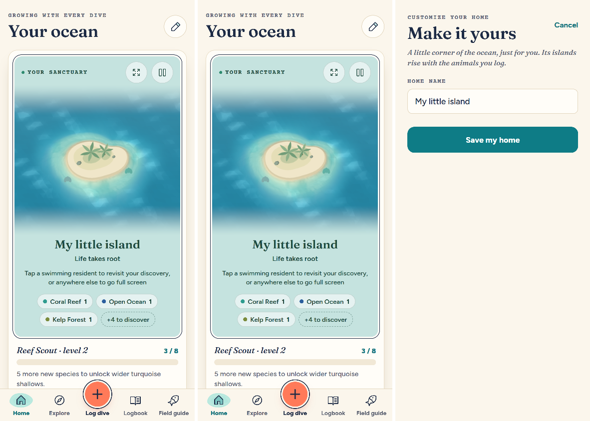
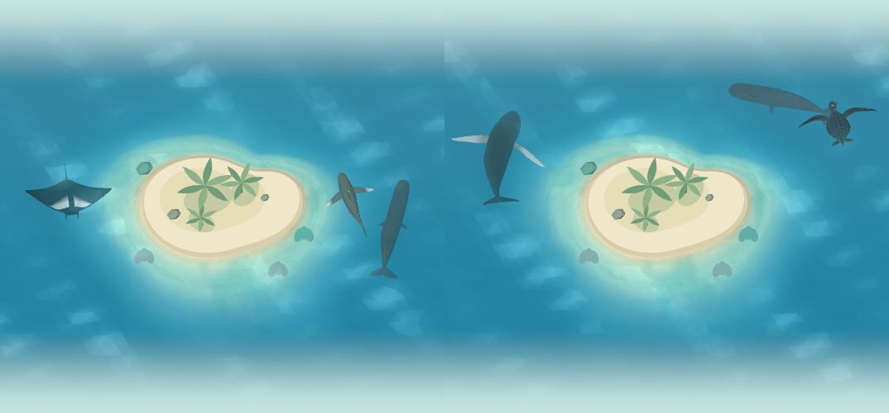

# The archipelago

Home is the diver's archipelago: the areas of the ocean their animals live in, each named for
the kind of place a diver meets them. Every species in the catalog lives in one area
(`src/lib/archipelago.ts`), and an area appears with the first species logged from it, so
the archipelago grows with the diver's own dives. There is no choosing it: the habitat picker
that used to offer a sandy island, a coral lagoon or a rocky cove is gone.

| Area | What it is | Who lives there | Species |
| --- | --- | --- | ---: |
| Coral Reef | A sandy palm island ringed with coral (Home's island today) | Reef sharks, the wobbegong, reef manta, hawksbill turtle, Napoleon wrasse, bumphead parrotfish, clownfish, angelfish and triggerfish, giant moray, day octopus, giant clam, Christmas tree worms, banded sea krait; golden jellyfish in a marine lake | 34 |
| Open Ocean | The deep blue all around the islands | Whale shark, oceanic whitetip, mako and silky sharks, oceanic manta and devil rays, humpback and sperm whales, dolphins, sailfish, yellowfin tuna, mola mola, leatherback and olive ridley turtles | 15 |
| Kelp Forest | A cold, rocky coast of towering kelp (its own island: `docs/kelp-forest.md`) | Great white and basking sharks, orca, sea lions, harbor seals, sea otters, leafy and weedy seadragons, garibaldi, giant sea bass, wolf eel, lingcod, giant Pacific octopus, giant cuttlefish | 14 |
| Mangroves & Seagrass | A warm, shallow lagoon of mangrove roots and seagrass | Dugong, manatee, green turtle, tiger, lemon, nurse and bull sharks, great hammerhead, sawfish, southern stingray, guitarfish, tarpon, seahorse, reef squid | 14 |
| Volcanic Pinnacle | A black lava island in strong currents | Schooling scalloped hammerheads, Galápagos and thresher sharks, eagle rays, marbled rays, barracuda, giant trevally, dogtooth tuna, king angelfish, chambered nautilus, marine iguanas | 11 |
| Black Sand Bay | A volcanic sand and rubble slope | Frogfish, mimic, coconut and blue-ringed octopuses, flamboyant cuttlefish, mandarinfish, garden eels, stonefish, ghost pipefish, pygmy seahorse, nudibranchs, harlequin and mantis shrimp | 23 |
| Shipwreck | An old wreck on the sand | Sand tiger sharks, goliath and giant groupers, great barracuda, lionfish, batfish, green moray, spiny lobster, loggerhead turtle | 9 |

A species that lives in more than one kind of place (green turtles graze seagrass and rest on
reefs) has one home, where divers meet it most. The test in
`src/lib/__tests__/archipelago.test.ts` checks that every species in the catalog has exactly
one, and that every area has residents.

## On Home

Under the island's hint, a row of pills names the areas the diver has found, in the order
they rose, each with a coloured dot (`color`, never the only cue) and how many of the diver's
species live there, then how many areas are still to discover ("+5 to discover"). Screen
readers hear it as one line ("Your archipelago: Coral Reef, 2 species; Open Ocean, 1 species;
5 more areas to discover"). The explorer's label reads "Exploring · " and the home's name.

The island on Home is the Coral Reef, drawn with the sandy island's shores (`HOME_SHORE`).
The other shores (`HABITATS`: the coral lagoon and the rocky cove) stay for the archipelago's
other islands. Levels still grow the island and its sea as the collection grows; the rewards
at levels 5 and 6 are its islets.

### Islands

Some areas have an island of their own (`ISLANDS` in `src/lib/archipelago.ts`, so far the Coral
Reef, which is Home's, and the Kelp Forest). An area's island rises with its first logged species
(`foundIslands`), and each species swims at its own area's island, or at Home's while its area
has none (`islandOf`, `islandResidents`): the Open Ocean's animals swim around Home's island,
being the deep blue around them all.

Home's card shows one island at a time. Once there are two, the area pills of the areas with an
island become buttons ("Kelp Forest, 3 species. Show this island"), the chosen one outlined; the
card's label names it ("Kelp Forest", or "Your sanctuary" for Home's), and its Explore button
opens the explorer on it (`/explore?island=kelp-forest`). A new species arriving
(`docs/discovery-moments.md`) switches the card to its own island, so the diver sees it arrive
where it lives.

## The Open Ocean's animals

The Open Ocean has no island of its own: it is the deep blue all around the others. Its first
five animals have their own 3D models: the humpback and sperm whales, the oceanic whitetip
shark, the leatherback turtle and the oceanic manta ray (`docs/marine-species-art.md`, batch
v5). Logged, they swim well out from the island, the whales coming up to breathe
(`docs/marine-navigation.md`). Its other residents swim as their family's model (the mako and
silky sharks, Munk's devil ray), as an existing species' (the whale shark, the dolphins, the
sailfish, the mola mola, the tuna school), or not yet at all (the olive ridley turtle).

## The Kelp Forest

The second island: a rocky headland with Monterey cypresses, ringed with beds of giant kelp
that sway with the surge and part around the animals swimming through them, in cold, green,
murkier water. Its first five animals have their own models: the harbor seal, the sea otter,
the garibaldi, the leafy seadragon and the orca (`docs/marine-species-art.md`, batch v6). All of it
is in `docs/kelp-forest.md`.

## Next

The islands of the other areas, each rising in the same sea as its first species is logged, and
better models for the Coral Reef's own animals.
