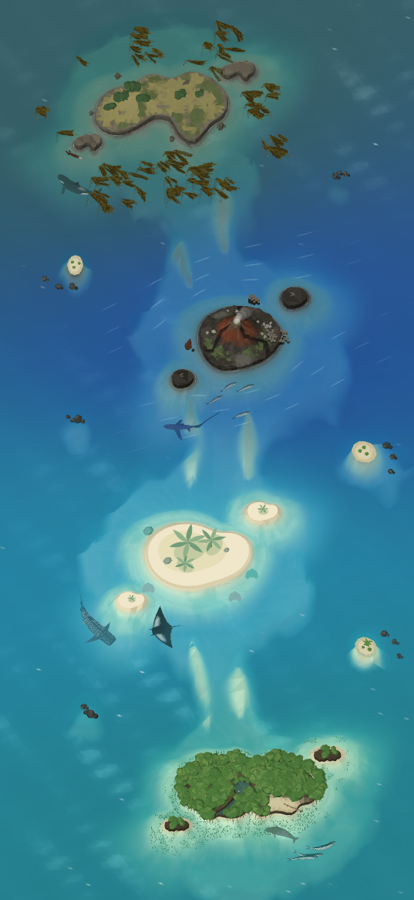
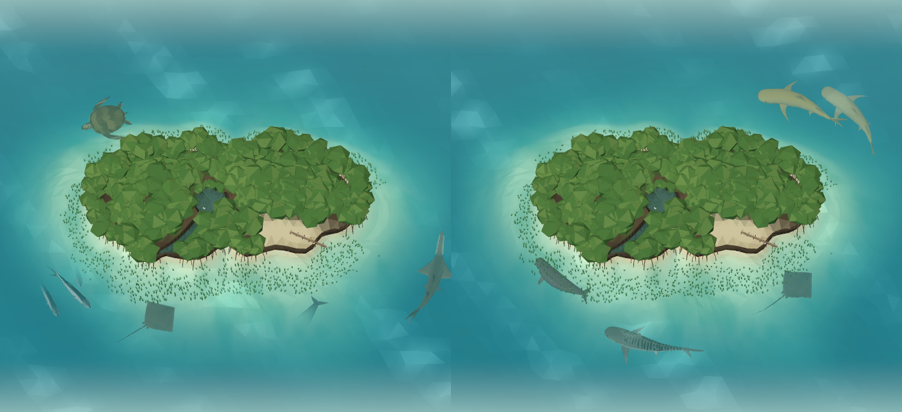

# The archipelago

Home is the diver's archipelago: the areas of the ocean their animals live in, each named for
the kind of place a diver meets them. Every species in the catalog lives in one area
(`src/lib/archipelago.ts`), and an area appears with the first species logged from it, so
the archipelago grows with the diver's own dives. There is no choosing it: the habitat picker
that used to offer a sandy island, a coral lagoon or a rocky cove is gone.

| Area | What it is | Who lives there | Species |
| --- | --- | --- | ---: |
| Coral Reef | A sandy palm island ringed with coral (Home's island today) | Reef sharks, the wobbegong, reef manta, hawksbill turtle, Napoleon wrasse, bumphead parrotfish, clownfish, angelfish and triggerfish, giant moray, day octopus, giant clam, Christmas tree worms, banded sea krait; golden jellyfish in a marine lake | 34 |
| Open Ocean | The deep blue all around the islands | Whale shark, oceanic whitetip, mako and silky sharks, oceanic manta and devil rays, humpback and sperm whales, dolphins, sailfish, yellowfin tuna, mola mola, leatherback and olive ridley turtles | 15 |
| Kelp Forest | A cold, rocky coast of towering kelp (its own island: `docs/kelp-forest.md`) | Great white and basking sharks, orca, sea lions, harbor seals, sea otters, leafy and weedy seadragons, garibaldi, giant sea bass, wolf eel, lingcod, giant Pacific octopus, giant cuttlefish | 14 |
| Mangroves & Seagrass | A warm, shallow lagoon of mangrove roots and seagrass (its own island: `docs/mangroves.md`) | Dugong, manatee, green turtle, tiger, lemon, nurse and bull sharks, great hammerhead, sawfish, southern stingray, guitarfish, tarpon, seahorse, reef squid | 14 |
| Volcanic Pinnacle | A black lava island in strong currents (its own island: `docs/volcanic-pinnacle.md`) | Schooling scalloped hammerheads, Galápagos and thresher sharks, eagle rays, marbled rays, barracuda, giant trevally, dogtooth tuna, king angelfish, chambered nautilus, marine iguanas | 11 |
| Black Sand Bay | A volcanic sand and rubble slope | Frogfish, mimic, coconut and blue-ringed octopuses, flamboyant cuttlefish, mandarinfish, garden eels, stonefish, ghost pipefish, pygmy seahorse, nudibranchs, harlequin and mantis shrimp | 23 |
| Shipwreck | An old wreck on the sand | Sand tiger sharks, goliath and giant groupers, great barracuda, lionfish, batfish, green moray, spiny lobster, loggerhead turtle | 9 |

A species that lives in more than one kind of place (green turtles graze seagrass and rest on
reefs) has one home, where divers meet it most. The test in
`src/lib/__tests__/archipelago.test.ts` checks that every species in the catalog has exactly
one, and that every area has residents.

## On Home

Under the island's hint, a row of pills names the areas the diver has found, in the order
they rose, each with a coloured dot (`color`, never the only cue) and how many of the diver's
species live there, then how many areas are still to discover ("+5 to discover"). Screen
readers hear it as one line ("Your archipelago: Coral Reef, 2 species; Open Ocean, 1 species;
5 more areas to discover"). The explorer's label reads "Exploring · " and the home's name.

The island on Home is the Coral Reef, drawn with the sandy island's shores (`HOME_SHORE`).
The other shores (`HABITATS`: the coral lagoon and the rocky cove) stay for the archipelago's
other islands. Levels still grow the island and its sea as the collection grows; the rewards
at levels 5 and 6 are its islets.

### Islands

Some areas have an island of their own (`ISLANDS` in `src/lib/archipelago.ts`, so far the Coral
Reef, which is Home's, the Kelp Forest, the Volcanic Pinnacle and the Mangroves & Seagrass). An area's island rises with its first logged species
(`foundIslands`), and each species swims at its own area's island, or at Home's while its area
has none (`islandOf`, `islandResidents`): the Open Ocean's animals swim around Home's island,
being the deep blue around them all.

Home's card shows one island at a time. Once there are two, the area pills of the areas with an
island become buttons ("Kelp Forest, 3 species. Show this island"), the chosen one outlined; the
card's label names it ("Kelp Forest", or "Your sanctuary" for Home's), and its Explore button
opens the explorer on it (`/explore?island=kelp-forest`). A new species arriving
(`docs/discovery-moments.md`) switches the card to its own island, so the diver sees it arrive
where it lives.

Each island has its own shape and size (`OUTLINES` in `src/lib/island-outline.ts`), so the
archipelago never looks like one island stamped four times: the Coral Reef keeps the sandy bean of
an island Home always had; the Kelp Forest is the largest, a long, rugged headland with an arm
hooking out south-west and a deep bay biting into its south side; the Volcanic Pinnacle is the
smallest, a nearly round cone with lava lobes reaching the sea; and the Mangroves & Seagrass is the
longest, a low cay with a ragged fringe of lobes. Each island's islets rise just off its own shore,
drawn with its own outline. Everything that follows a coast uses its island's shape (`shapeFor`):
the coasts themselves, the seabed and shallows around each in the one ocean, the kelp and seagrass,
the reef's dens and anemones, the small life's homes, and the animals steering around it.

The explorer shows them all together, in one ocean: each island at its place (`ISLAND_PLACES`),
to sail between by dragging across the water or with a button for each island
(`docs/island-explorer.md#one-ocean`). They lie in a chain running north to south, each a little to
one side of the last, like the cays of the Bahamas strung along their bank: the Kelp Forest farthest
north, in colder water; then the Volcanic Pinnacle, in the clear blue of the currents; Home's Coral
Reef; and the Mangroves & Seagrass to the south, in warm green shallows. A chain suits a phone held
upright, narrow and tall: all the way out it shows every island larger than a cluster would. Each
island still keeps its animals' water to itself (its swimming area at the last level never reaches
another's).

### The bank between the islands

Seen from above, an archipelago is not a few islands in an empty sea: they stand together on a
shallow bank, and the water between them is as much of the view as the islands. `src/lib/banks.ts`
lays it out as plain data (`archipelagoBank`, the same every time), and the ocean's depth field
(`docs/ocean.md`) takes its depth wherever it is shallower than an island's own seabed:

- **The bank.** A broad platform around each island (`BANK.platform`, its edge wandering in and out)
  and a saddle joining each pair of neighbours, narrowest midway between them, all of it a metre or
  so of clear turquoise water over pale sand in soft patches (`BANK.depth`), dropping away at its
  ragged edge (`BANK.edge`) to the deep blue of the open ocean.
- **Sandbars.** Along each saddle, a pale streak where the sand rises almost to the surface
  (`BANK.sandbar`), one off each side of the line between the islands.
- **Cays.** Out on the flanks between neighbours, small cays of bare sand break the surface, each in
  a ring of sandy shallows, some with a palm and all with a few low shrubs.
- **Rocks.** Dark rocks stand on their own shoals, seaward of each cay.

Every cay and rock stands outside every island's swimming area at the last level, and well clear of
its shore and islets, so they never stand in an island's animals' way. With one island alone (Home's
card), there is no bank. `src/components/home/three/archipelago-sea.tsx` draws the cays, palms and
rocks in one flat-shaded mesh.

### The sea from high above

All the way out over several islands, the waves' highlights would repeat across the open sea as
regular stripes. So pulled back, the sea is seen as from high above (`uOceanCalm`, set by the
explorer's camera from its zoom): the waves' glints gather into broad wind patches drifting across
the water, the facets soften, and small whitecaps fleck the deep water off the bank. Zooming in on an
island brings the waves back as they always are close up.

## The Open Ocean's animals

The Open Ocean has no island of its own: it is the deep blue all around the others. Its first
five animals have their own 3D models: the humpback and sperm whales, the oceanic whitetip
shark, the leatherback turtle and the oceanic manta ray (`docs/marine-species-art.md`, batch
v5). Logged, they swim well out from the island, the whales coming up to breathe
(`docs/marine-navigation.md`). Its other residents swim as their family's model (the mako and
silky sharks, Munk's devil ray), as an existing species' (the whale shark, the dolphins, the
sailfish, the mola mola, the tuna school), or not yet at all (the olive ridley turtle).

## The Kelp Forest

The second island: a rocky headland with Monterey cypresses, ringed with beds of giant kelp
that sway with the surge and part around the animals swimming through them, in cold, green,
murkier water. Its first five animals have their own models: the harbor seal, the sea otter,
the garibaldi, the leafy seadragon and the orca (`docs/marine-species-art.md`, batch v6). All of it
is in `docs/kelp-forest.md`.

## The Volcanic Pinnacle

The third island: a young lava cone with a steaming vent in its crater, black basalt shores and
coves of black sand, tree cactus and pale palo santo on its slopes, a causeway of basalt columns
and a lone spire of rock, in clear cobalt water. Its first five animals have their own models: the
marine iguana, the Galápagos shark, the pelagic thresher, the giant trevally and the king
angelfish (`docs/marine-species-art.md`, batch v7); the scalloped hammerheads school here and the
spotted eagle rays fly in squadrons. All of it is in `docs/volcanic-pinnacle.md`.

## The Mangroves & Seagrass

The fourth island: a low cay under a dense canopy of mangroves, red mangroves standing out in the
water on their prop roots all round it, a tidal creek winding in to a lagoon at its heart, a spit of
pale sand with a boardwalk and wading egrets, in a
warm, turquoise lagoon ringed with seagrass meadows that sway with the surge. Its first five animals
have their own models: the dugong, the largetooth sawfish, the lemon shark, the southern stingray
and the tarpon (`docs/marine-species-art.md`, batch v8); the tiger sharks, great hammerheads and
green turtles, which used to swim at Home's reef, live here now. All of it is in `docs/mangroves.md`.

## Next

The islands of the other areas, each rising in the same sea as its first species is logged, and
better models for the Coral Reef's own animals.
