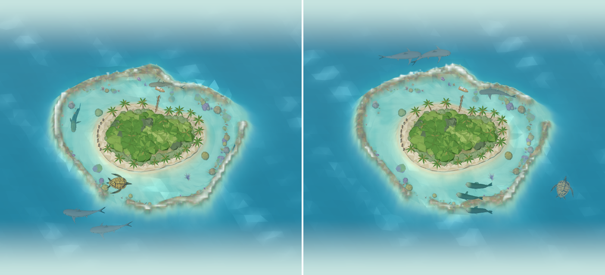

# The Coral Reef

Home's island (`docs/archipelago.md`): a coral cay like Heron Island or the cays of the Maldives,
a low island of white coral sand under a bright forest, standing in a pale lagoon inside a ring of
reef where the swell breaks. It is there from the start; in the explorer it lies in the middle of
the chain, the Volcanic Pinnacle to the north and the Mangroves & Seagrass to the south
(`docs/island-explorer.md#one-ocean`). Its own animals (the six below, and the reef manta, the
octopus, cuttlefish, moray and clownfish of `docs/marine-species-art.md`) swim here, and so does
every species of an area that has no island of its own yet.

## The island

`src/components/home/three/reef-coast.tsx` builds the cay as one flat-shaded, vertex-coloured mesh
in the island's own (scaled) frame, from the building blocks it shares with the other coasts
(`coast-geometry.ts`):

- **The shape.** The sandy bean Home's island always had (`OUTLINES.reef` in island-outline.ts).
- **The beach.** White coral sand from the water up to a low berm (`TOP`), wet and darker at the
  waterline, with a line of wrack (dried seagrass and coral rubble) along its top; slabs of grey
  beach rock lie along the west shore (`ROCKS`).
- **The forest.** Inland, a dense forest on a jittered lattice, rising a little toward the middle,
  with clearings where the grass shows: mostly bright green, with paler, yellower pisonia and
  darker grey-green she-oaks among it. Between it and the beach, a hedge of silvery shrubs.
- **Palms.** Coconut palms lean out over the beach all round and stand among the trees: slender,
  curving trunks under crowns of long fronds that arch up and droop, each a folded strip of
  leaflets, the lowest ones yellowed.
- **The jetty and the dive boat.** A jetty runs out from the north shore over the lagoon (`JETTY`
  in `src/lib/reef-coast.ts`: the one stretch of shore with no den, rock, anemone or small life's
  home off it) to a moored dive boat: a white hull with a blue stripe, a canopy over its stern and
  dive tanks racked down its sides.
- **What each level adds.** Showpiece corals in the lagoon grow in where the island's corals always
  stood (`SEABED_PROPS`): a table coral and a brain coral from level 2, a staghorn thicket and a
  reef rock from level 3; another palm among the trees from level 4; and from level 5 and 6 the
  islets rise out on the reef as little cays of sand with shrubs and a palm or two.

## The lagoon and the reef crest

Around any other island the shelf drops away to deep water. Around the Coral Reef it runs on as a
broad lagoon of pale sand, out to a reef crest that rises almost to the surface, where the swell
breaks, and only then does the reef's outer slope fall away to the deep, as a steep wall, so that the
water just outside the crest is deep enough for a whale shark or a manta (`seabedProfile` with the
reef's place, `OCEAN.reefCrest` in `src/lib/ocean.ts`; the animals' side of it is in docs/marine-navigation.md). At levels 5 and 6
the wall runs on round the islets' reefs too, from right at their crest's outer edge (`isletWall`), turning into the main island's
where the reefs meet, so the deep water goes on round them; the islets, their lagoons and their crests look as they did. The crest is never a neat ring
(`OCEAN.reefShape`): it wanders in and out, its outer edge is cut into spurs and grooves, and two
boat passes break it where the lagoon opens to the sea. Its seabed has rings of its own to pick out
the crest's rise and the wall, which follow the wall round the islets' reefs as well (`seabed-lattice.ts`, drawn by `createSeabedMesh`).

The ocean's depth map carries a coral channel (`reefCrestAt`, and the bommies' rubble): the seabed
is painted with a mottle of coral browns, olive and rose over the crest and round each coral head,
and on the crest's seaward edge the water breaks into surf, sets of white water rolling along the
reef, torn into streaks, never quite clearing between them (`oceanSurf` in ocean-mesh.ts). Over the
crest and the lagoon the waves flatten (they shoal over the shallow water); the lite tier bakes the
coral and a still line of surf into its map. Everything that stands on the reef's bottom follows the
same seabed: the octopus's rocks, the morays' dens, the anemone and the small life's homes
(`locate` and the reef's floor in `src/lib/reef-life.ts`).

## The coral

`src/lib/reef-coast.ts` places the coral heads as plain data (`coralHeads`, `CORAL`), the same
every time: bommies clustered in patch reefs across the outer lagoon, with bare sand between, more
of them with every level (`cover`), and smaller corals crowding the crest's inner slope up to just
under the surface (`clearance`), all of them out beyond the reef's dens, rocks and anemone and clear
of the showpiece corals and the boat (`clear`). Each is one of a few kinds (`coralGeometry`):
massive domes of porites, brain corals ridged in two tones, table corals of two or three uneven,
tipped plates on a stalk, staghorn thickets pale at their tips, and soft corals and red and orange
sea fans. `ReefCorals` draws them in one mesh on the bottom like the reef's rocks (drawn behind any
animal over them, `FLOOR_BIAS`), taking on the water over them; lite quality keeps half the crest's.

## Its animals

| Species | Swims | Movement |
| --- | --- | --- |
| Grey reef shark | Quick, easy beats of the tail, the black-edged tail sweeping | Patrols the outer reef and the crest at mid-depth, swinging out over the drop-off; now and then two together |
| Blacktip reef shark | Quick, shallow beats, a little more roll | Hunts close in over the lagoon's shallows, high in the water, weaving |
| Whitetip reef shark | Slow, sinuous sweeps, the head held steady | Rests on the bottom for long spells, then sets off along the reef, low down |
| Hawksbill turtle | Quicker strokes of its long fore flippers than the green turtle's, shorter glides | Flies along the reef from one sponge to the next, stopping to feed |
| Napoleon wrasse | Rows on its broad pectoral fins, the tail beating slowly | Big and curious: rows slowly over the reef, turns to look, hangs a while |
| Bumphead parrotfish | Rows on its pectorals, slow beats of the tail | A herd of two or three grazing the reef side by side, pausing together to bite at the coral |

The potato cod swims as the goliath grouper, its fellow giant grouper (`docs/marine-species-art.md`,
batch v9); the other reef sharks and reef fish still swim as their family's model.

Tests: `src/lib/__tests__/coral-reef.test.ts` (the lagoon and the crest, the coral heads and what
they keep clear of, the surf, and the reef's animals), and `reef-life.test.ts` (the rocks and dens on
the reef's seabed). `npm run verify:ocean` checks the crest stays under the surface, calms the waves
and carries surf, and the lagoon's floor.

## Known limitations

- The surf breaks along the crest's whole seaward edge at once; real sets roll in from one side.
- The boat never leaves its mooring, and nobody dives from it.
- Coral heads are scattered by rule, not grown: the patch reefs don't follow the currents.
