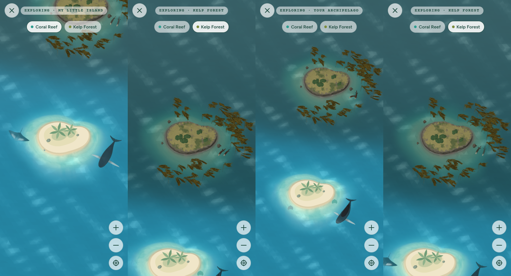

# Island explorer

The diver's archipelago full screen: every island they have found, in one ocean, to sail
between, zoom in on and look around ([One ocean](#one-ocean)). It opens with a tap
anywhere on the Home card's island that isn't an animal (a tap on an animal still opens
its page), or from the full-screen button (four arrows, "Explore your ocean full
screen") beside the pause button, once an animal swims there or small life lives on the
reef, and closes with ✕. The card's tap is an invisible floor far below the seabed
(`TapAnywhere`), so any animal's tap target is hit first; a press that moves more than
`TAP_SLOP` is a drag or the page scrolling, not a tap. (It is not the **Explore** tab, which is the map of dive sites.)
The islands, their animals and their behavior are Home's: the explorer draws the same
`SanctuaryScene`, with every island in it, its own camera, water that reaches past every
edge of the screen, and the reef's small life, too small for the card ([Macro life](#macro-life)). The route is
`src/app/explore.tsx`; the camera maths, the gestures and every tunable are in
`src/lib/explorer-view.ts` (`EXPLORER`); the camera itself is
`src/components/home/three/explorer-camera.tsx`.

## Using it

| To | Touch | Mouse (web) | Buttons |
| --- | --- | --- | --- |
| Look closer or farther | Pinch, about the fingers, to any zoom in between | Wheel (or a trackpad pinch), about the pointer | **+** and **−** (1.6× a press) |
| Look closer at a spot | Double tap with one finger (2×) | Double click | |
| Look around | Drag (let go fast to glide on), with one finger or several | Drag | |
| See the whole ocean again | Double tap when all the way in | | **⌖** "Show the whole ocean" |
| Go to another island | Drag across the water to it | Drag | Its name under the label ("Kelp Forest. Sail there") |
| Revisit a discovery | Tap the animal | Click it | |
| Find the reef's small life | Tap its home (a sea fan, a starfish…) to zoom in on it, then tap the creature | Click | |

It opens all the way out: the whole ocean and every animal in view, the water filling
the screen. Pinch in from there to see the smaller things, and back out: between all
the way out and all the way in, the zoom is wherever the fingers leave it. Pinched past
either end, it stretches a little and springs back. A hint
("Pinch or double-tap to look closer · drag to look around") shows for five seconds,
with a second line when small creatures live on the reef ("2 small creatures live on
the reef: zoom in close to find them").

## One ocean



Every island found so far lies in one ocean, at its own place (`ISLAND_PLACES` in
`src/lib/archipelago.ts`): the Coral Reef, Home's, in the middle, the Kelp Forest
12.5 units to the north and the Volcanic Pinnacle 12 to the south (and a little west), far
enough that each island's swimming area (at the last level) has water of its own, with open
sea between. Each island's animals swim around it as on Home (each island runs its own
simulation, in its own frame), and the water around each is its own: tropical turquoise
around the reef, cold green around the kelp, clear cobalt around the volcano, blending
across the open sea between them ([Island ocean](ocean.md#islands-in-one-ocean)).

- **Where it opens.** On the island chosen on Home (`/explore?island=kelp-forest`; Home's
  unless another is named), as the explorer would open on that island alone: its whole
  swimming area on screen (`islandView`). If the collection is still loading as it opens,
  it moves there once the islands are known, unless the view has already been moved
  (`open`). On a tall phone that view is tall enough to show the next island too.
- **Getting between them.** Drag across the water, or press an island's name under the
  label (one button per island, with its area's coloured dot) to sail there (`visit`).
  The middle of the view may go anywhere between the islands, and around each as far as
  it could around an island alone (`panLimit`).
- **The label** names the island the view is over (`nearestIsland`, heard through
  `near`), or "Your archipelago" in the open sea between two (nearer one than the other
  by less than `between`, 30%, of the way across). Screen readers hear it change; the
  island's button is marked selected.
- **All the way out** (and **⌖**) shows every island's swimming area at once.

With Home's island alone, the explorer is exactly as it was: the same zoom range, limits
and opening view.

## How it works

**The view.** A view is the point on the water in the middle of the screen (x, z) and
the zoom, in screen points per world unit. The camera keeps Home's angle (from
(0, 12, 6) looking at (0, −0.15, 0)) and moves over that point. Looking down at an
angle foreshortens the water's depth, so a drag up the screen covers
`depthStretch` (about 1.115) times the water a drag sideways does; the gestures use it
so the water under the fingers stays under them.

**All the way out, and in.** All the way out is where it opens: the swimming area and
`frame` (0.6 units) of water around it in view, so every animal is on screen, whatever
the island's level. All the way in, the screen's shorter side spans `closest` (1.1
units): close enough to find the reef's small life, a nudibranch a sixth of a phone's
width.

| Screen | Level | Zoom range (pt/unit) | Water across × deep, all the way out |
| --- | ---: | --- | --- |
| Phone, 390 × 844 | 1 | 35 – 355 (10×) | 11 × 26.5 units |
| Phone, 390 × 844 | 6 | 30 – 355 (11.8×) | 13 × 31.3 units |
| Tablet, 1180 × 820 | 6 | 79 – 745 (9.4×) | 14.9 × 11.5 units |
| Laptop, 1440 × 900 | 1 | 102 – 818 (8×) | 14.1 × 9.8 units |

The Home card shows the island at 31 pt per unit (`SCENE_CAMERA`), so a phone opens
about as the card frames it, taller, and zooms in about ten times.

**Water to every edge.** A tall phone all the way out sees far more depth than the
Home card's water covers (it stops at `OCEAN.waterExtent`, 8.6 units, which the card's
view never reaches past, and fades its top and bottom into the card). So in the
explorer the water reaches `reach` (18 units) each way from every island's middle, the
deep floor under it, and there is no haze: open water runs to every edge of the
screen at every zoom, and the view never goes past it. The Home card's own water is
unchanged.

**How far across.** Around an island, the middle of the view may roam until the view's
edges are `margin` (2 units) past the swimming area, or at the water's edge if that is
nearer (`panLimit`): an animal at the edge of its range is in full view, and a phone
zoomed in a little can move up and down as well as across. With more than one island,
it may also go anywhere between them.

**The fingers.** The explorer follows the fingers themselves, from the first touch
(`touch`, every time any finger moves, lands or lifts), rather than waiting for a
pinch or a drag to be recognized and then catching up in a jump:

- Their middle drags the water and their spread zooms about it. The new view is found
  in one go, keeping the water that was under their middle under it at the new zoom,
  and only then kept inside the limits (`followFingers`), so the limits of the old zoom
  never stop a move the new one allows.
- The fingers' moves are followed when the camera next draws, all together. On the web
  each finger's move comes as an event of its own: followed one finger at a time, a
  pinch near the edge could zoom out halfway, meet the edge's limit there (it draws in
  as the view zooms out), and leave the water slipping under the fingers. Phones send
  every finger's move at once.
- When a finger lands or lifts, the fingers' middle jumps, so the view stays exactly
  where it is and carries on from there.
- Pinched past all the way in or out, the zoom stretches on (`stretchZoom`), giving less
  the farther the fingers go, to `stretch` (1.25×) at most; out past all the way out,
  never so far that the water stops filling the screen. When the fingers lift it eases
  back to the limit, about where they were. A finger landing as it springs back catches
  it there, and the fingers carry on from that zoom without a jump.
- A double tap is two quick taps with one finger (each down no longer than `tapTime`,
  300 ms, moving no farther than `tapSlop`, 10 pt, the second within `tapGap`, 300 ms,
  and `tapNear`, 40 pt, of the first). The explorer tells it apart from the other
  touches itself. A tap gesture from the gesture library counted any touch under half a
  second as a tap, pinches included, however far the fingers moved: two quick pinches
  to zoom out were a double tap, and zoomed back in twice as close.
- Fingers closer together than `pinchFloor` (12 pt from their middle) only drag: real
  fingers are never much closer, and at that size a wobble would snap the zoom.
- Let go of a single finger moving fast (over `flick`, 250 pt/s, measured over its last
  `sample` 100 ms, and only if it hadn't stopped) and the view glides on at that speed
  (at most `topSpeed`, 2,500 pt/s) and slows (`friction`). Nothing glides after a
  pinch, or after a touch the system takes away.

A drag and a pinch gesture are still attached, but only to claim the touch once it
moves or spreads, so that looking around never also taps an animal. There is no tap
gesture.

**Tap targets.** Slender animals have invisible tap targets at least 28 pt across
(`MIN_TAP`, see [island navigation](marine-navigation.md#a-growing-ocean)). In the
explorer they keep that size on screen at any zoom (`tapScaleAt`), so close up they hug
the body instead of covering its neighbours. The explorer tells them its zoom only when
a move ends (the fingers lift, an eased move settles; the mouse wheel as it turns), so
the island is never re-drawn by React in the middle of a pinch, which on a phone would
stall it. A press that moves more than `TAP_SLOP` (8 px) is a drag, not a tap.

**Buttons and taps.** Buttons and double taps ease to their goal (`ease`, the zoom eased
in log space so it feels even); a finger coming down stops any glide or eased move
where it is. The mouse wheel zooms at once, about the pointer (`zoomAt`).

**Drawing.** The canvas draws continuously while the animals swim. When they are still
(Reduce Motion, or still loading) the island draws only on demand, so the camera asks
for a frame on every move, and keeps asking while a glide or an eased move settles.
Home's own island pauses while the explorer is open (its screen loses focus). The
explorer's larger water is about 8,700 vertices against the card's 2,058, and its
seabed 2,784 against 2,400; with the Kelp Forest too, about 12,300 and 4,900; with the
Volcanic Pinnacle as well, 16,800 and 7,266.

**Only what's in view.** Off screen, animals rest (`view-cull.ts`, `onScreen`: a point's place on
screen as the camera last drew, with a margin):

- An animal more than a body length past the screen's edge isn't drawn and its skeleton isn't posed
  (`AnimatedMarine`); its swimming goes on, so it is where it should be when it comes back.
- An island none of whose water is on screen (its swimming area and 2 units around it) stops its
  simulation altogether (`MarineSwimmers`): its animals and school wait where they are, and its kelp
  stops hearing about them. Zoomed in on the Kelp Forest, the reef's animals cost nothing.
- The kelp is culled with the rest of the scene (its bounds padded a unit for the sway).

Measured in the web harness with four animals at each island: all the way out, 6 of 8 drawn (the
others diving); zoomed in on the Kelp Forest, 3; on the reef, 2. The Home card is unchanged, but for
an animal waiting out of frame to arrive, which now rests until it swims in.

## Macro life

The reef's small life: every macro species in the catalog has a creature that lives in
a home of its own on the shelf, near the beach where the water is shallow enough to
see it. Like the island's animals, only the diver's logged species are there. They
are too small for the Home card, so they are drawn only in the explorer
(`src/lib/macro-life.ts`, `src/components/home/three/macro-life.tsx`).

| Species | Home | What it does |
| --- | --- | --- |
| Anna's chromodoris | A low rock grown with an orange sponge | Crawls slowly round the rock's top, its gills swaying |
| Pikachu nudibranch | A rock tufted with hydroids | Crawls round the rock's top the other way |
| Spanish dancer | A sandy patch scattered with coral rubble | Crawls a slow loop, the frilled edge of its mantle rippling |
| Pygmy seahorse | A sea fan | Sways with the fan; pinker than the fan, and only just findable |
| Ornate ghost pipefish | A feather star on a rock | Hangs head-down beside it, drifting |
| Harlequin shrimp | A blue starfish | Waves its great petal claws |
| Peacock mantis shrimp | A burrow ringed with rubble | Comes out to look about for 7 s, then backs in for 6 |
| Caribbean spiny lobster | A rock ledge | Peers out from under it, sweeping its long antennae |
| Christmas tree worm | A coral head | Seven worms, each now and then snapping into its tube and unfurling again |
| Giant clam | A bed of coral rubble | Its mantle breathes; every half minute it half-closes, then opens |

**Where.** Each home is at a fixed angle around the island and reach out on the shelf
(`HOMES`), moving out as the island grows. Every home stays clear of the corals, the
reef rock and every moray den (and the moray resting half out of it, along the coast),
octopus rock and anemone, even if all of them are on the island at once, and clear of
the islets and of each other at every level. The
camera side of the island is the most crowded, so the homes there sit nearer the
beach.

**When.** Homes show at every zoom, as a hint of where to look. The creatures fade in as
the explorer zooms from `MACRO.appear` (100 pt per unit) to `MACRO.clear` (150): on a
phone, three presses of **+** or two double taps. The thresholds are in screen terms, so
a creature is the same size on screen whenever it appears, on any device.

**Tapping.** From farther out, a tap on a home eases the view over to it and in, to 240
pt per unit, with the creature in the middle. Once the creatures are in view, a tap on
one (or its home) opens its page. Tap targets keep at least 28 pt on screen.

**Drawing.** The creatures and their homes are built in code from a small kit of tubes,
lathes and lumpy blobs (`macro-shapes.ts`, `macro-creatures.ts`), flat-shaded with one
color per face like the island's other low-poly props. They take on the water like the
reef's rocks and anemones; the creatures take on less of it, so they stay bright. All
ten together are about 10,700 triangles (6,900 in the lite quality for software
renderers) in at most 35 meshes, drawn only in the explorer. Their motion is cheap: parts
turning or sliding, and a few hundred vertices on the Spanish dancer's mantle.

**On Home.** Logging a macro species shows "New on your reef: Pygmy Seahorse. Go full
screen and zoom in close to find it" where an arriving animal would swim in. A
collection of only small life still opens full screen (the button, or a tap on the
island), and the card says the creatures live on the reef, too small to see from there.

## Accessibility

- Every gesture has a button: zoom in, zoom out and show the whole ocean, each 44 pt
  with a label. Close is a labelled button too.
- With Reduce Motion on, the animals hold still as they do on Home, buttons and double
  taps jump to their goal instead of sweeping, nothing glides, and the hint disappears
  instead of fading.
- The scene is one labelled image for screen readers, as on Home; its description adds
  how to look closer and around, and how many small creatures live on the reef.
- The reef's small life holds still with Reduce Motion, like the animals, in a pose
  that shows every creature: the mantis shrimp out of its burrow, the worms out of their
  tubes, the clam open.

## Tuning

| `EXPLORER` | Default | What it does |
| --- | ---: | --- |
| `reach` | 18 | How far the explorer's water reaches from the island's middle (units, each way) |
| `edge` | 0.3 | How close the water's own edge may come to the screen's (units) |
| `frame` | 0.6 | Water around the swimming area all the way out (units) |
| `margin` | 2 | How far past the swimming area the view may roam (units, up to the water's edge) |
| `closest` | 1.1 | Water the shorter side spans all the way in (units); lower to zoom closer |
| `step`, `doubleTap` | 1.6, 2 | Zoom per button press, and per double tap (×) |
| `stretch` | 1.25 | How far past the zoom limits a pinch stretches before springing back (×, at most) |
| `tapTime`, `tapSlop` | 300, 10 | A tap: one finger, down at most this long (ms), moving at most this far (pt) |
| `tapGap`, `tapNear` | 300, 40 | A double tap: the second tap within this long (ms) and this far (pt) of the first |
| `ease` | 6 | How quickly a button's or double tap's move settles (1/s) |
| `friction` | 4.5 | How quickly a glide slows (1/s) |
| `flick`, `topSpeed` | 250, 2500 | Slowest release that glides, and the fastest glide (pt/s) |
| `sample` | 100 | How far back the release speed is measured (ms) |
| `pinchFloor` | 12 | Fingers closer than this (pt from their middle) only drag |

## Verifying

```sh
npx jest src/lib/__tests__/explorer-view.test.ts src/components/home/__tests__/explore-screen.test.js
```

The tests cover:

- opening all the way out with the whole swimming area in view and water to every edge,
  on phones (levels 1 and 6, tall and short), tablets and laptops;
- panning and zooming about a point, and the limits;
- one finger keeping the water under it, move by move;
- two fingers zooming with their spread and keeping the water between them as they
  move; fingers almost together only dragging;
- fingers moved one at a time, as the web sends them, counting as one move, so a limit
  met halfway (near the edge) holds nothing back;
- a finger landing or lifting never moving the view, and no glide after a pinch;
- quick pinches in a row never counting as a double tap, however quick, while two quick
  one-finger taps do, about that spot; a finger that drags or lingers, taps too far apart
  in time or place, or a tap then a pinch, doing nothing;
- pinching past either limit stretching with more and more resistance, about the
  fingers, and springing back as they lift; a finger landing as it springs back carrying
  on without a jump; Reduce Motion going straight back;
- a fast release gliding (no faster than the top speed); a slow one, one that stopped
  first, or a cancelled one staying put;
- 400 random multi-finger sessions (drags, pinches, twists, fingers landing and lifting)
  on three screens: after every touch, the water under the fingers is still under them
  unless the water's edge stopped it, the zoom is exactly their spread's (stretched past
  the limits), nothing moved when a finger landed or lifted, and every touch ends back
  inside the limits;
- tap targets hearing the zoom only when a pinch ends;
- buttons and double taps easing in and back out, the wheel, and showing the whole ocean;
- focusing on a spot (a reef creature's home tapped from afar): easing over and in, never
  back out, within the limits;
- every move heard (for on-demand drawing), and Reduce Motion jumping instead of sweeping;
- the screen: starting all the way out, the buttons, tap targets following the zoom,
  closing, no tap gesture attached, and the hint (with its line about small life on the
  reef).

```sh
npx jest src/lib/__tests__/macro-life.test.ts src/components/home/__tests__/sanctuary-scene.test.js
```

- every macro species in the catalog having a creature;
- every home in the water on the shelf, clear of the reef's props, the islets and each
  other at all six levels, moving out as the island grows;
- the creatures coming into view only as the explorer zooms in close;
- only logged macro species on the reef, only in the explorer, each opening its page,
  and a tap from afar looking closer.

`npm run verify:ocean` checks the Home card's water (still 2,058 vertices), and
`npm run verify:underwater` the 28 pt tap minimum at levels 1 and 6.

## Known limitations

- Far out, the open water is the same deep blue all the way to the edge: there is
  nothing out there yet, and no animal swims from one island to another.
- Islands not yet found aren't there at all, not even as a silhouette on the horizon.
- Home's island stays mounted, paused, while the explorer is open, so two GL contexts
  are alive at once.
- The reef's animals pay the small life no attention: a crawling octopus may pass over
  a nudibranch's rock, drawn above it.
- The pygmy seahorse is about 32 pt tall on a phone all the way in: finding it is meant
  to take a moment.
- On the first island a palm frond hangs over part of the ornate ghost pipefish's
  feather star when zoomed all the way in; the pipefish itself stays in view.
- Opening an animal's page from the explorer pushes it above the explorer, and back
  returns to the explorer where it was.
