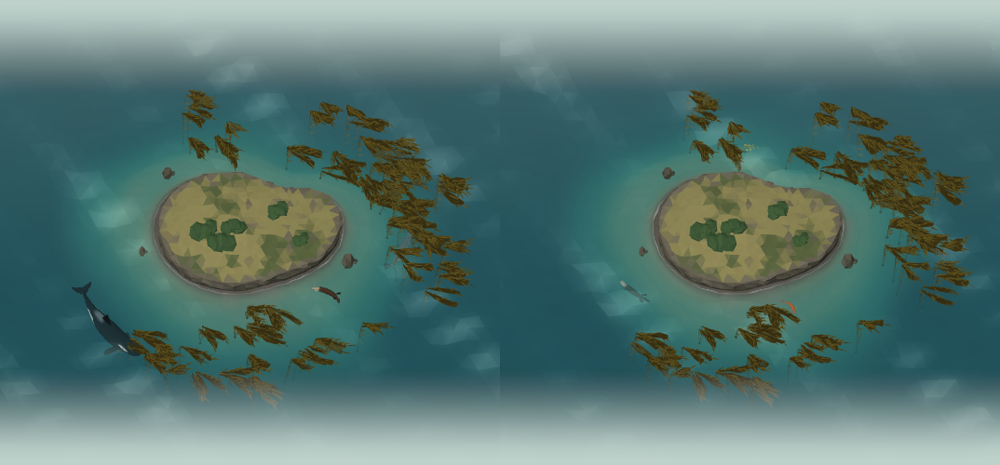

# The Kelp Forest

The archipelago's second island (`docs/archipelago.md`): a cold, rocky coast ringed with giant
kelp. It rises the first time the diver logs a Kelp Forest species, and from then on Home's area
pills switch between it and the Coral Reef; in the explorer it lies to the north of the reef, in
the same ocean (`docs/island-explorer.md#one-ocean`). Its own animals (the five below, and any other Kelp
Forest species swimming as a relative's model) swim here; everything else swims at Home's island.

## The island

`src/components/home/three/kelp-coast.tsx` builds the whole coast as one flat-shaded,
vertex-coloured mesh in the island's own (scaled) frame:

- **Cliffs.** The island's outline (the same one the animals steer around) extruded into rough
  rock walls from under the water (`FOOT`) to the clifftop (`TOP`), jittered and darkened toward
  the waterline where the rock is wet.
- **The headland's top.** The outline filled with evenly spread facets: a jittered lattice of
  points joined by a Delaunay triangulation (`delaunay()`; earcut with interior points made
  slivers), lifted over a low hill (`HILL`). Sun-dried golden grass, soft-edged patches of coastal
  scrub thicker in the hollows, and bare rock at the cliff edge and in outcrops, each blended into
  the grass rather than stopping at a line.
- **Monterey cypresses.** Five short, leaning trunks under broad, flat-topped, wind-sheared crowns.
- **Rocks.** Boulders along the foot of the cliffs, three sea stacks standing off the shore, and
  the level 5 and 6 islets as rocky ones.

## The kelp

Giant kelp (*Macrocystis pyrifera*) grows in beds on the rocky reef around the island, from the
edge of the surf out to deep water, with channels of open water between the beds.

- **Placement** (`src/lib/kelp.ts`, plain data). Candidate holdfasts on a jittered grid in the
  reef band (`KELP.band`, measured from the shore), kept where the bed noise is high (`cover`), so
  they clump. Each plant's holdfast sits on the seabed's floor there, and it rises to the surface
  with two to four stipes; its canopy streams with the current (`current`, varied per plant). The
  same every time; lite keeps an even subset of the same plants (66 full, 32 lite).
- **Geometry** (`kelp-geometry.ts`). Every plant in one merged mesh: a dark knobbly holdfast; each
  stipe a thin olive ribbon, bowed and gently S-bent; narrow blades along it on small gas floats,
  turning about it and angled up toward the light; at the surface, the stipe lies along the water
  as a runner, under a ragged plume of floating fronds widening downstream, with long, narrow
  blades streaming from it, lighter at their tips, every other one on a round yellowish float.
  About 15,700 triangles at full quality, 5,500 in lite (`npm run verify:underwater` checks the
  budget, that every vertex is finite, and that the canopy floats at the surface).
- **Colour.** Olive-brown stipes, olive-gold blades, a golden-tan canopy. The vertex colours are
  dark because the scene's lighting brightens flat, sun-facing blades about two and a half times;
  lighter colours turned the canopy to yellow straw.
- **Motion** (`kelp-forest.tsx`, all in the vertex shader from each vertex's `aKelp`: its rise
  from the holdfast, how far along the canopy it is, its plant's phase, and how freely it
  flutters). The surge swings each stipe along the current, more toward its top
  (`KELP.surge`), as a wave travelling through the forest; the canopy meanders along the surface
  and floats on the waves (the same `oceanWave` the water uses); the blades flutter. The kelp
  shares the island's water clock, so it stills when the scene pauses.
- **Under the water** the kelp takes the same depth tint, refraction and haze as the animals
  (`underwater-material.ts`), so the stipes fade into the green below the golden canopy.

### Swimming through it

The animals swim through the kelp, and it makes way for them: every frame the swimmers
(`marine-swimmers.tsx`) write each visible animal's middle and size into a shared uniform of 12
slots (`kelp-movers.ts`), and the kelp's vertex shader pushes the stipes and blades near one
aside, at its depth, more toward their tops, the holdfast staying put. In lite quality the loop is
compiled out (`KELP_LITE`) and the kelp only sways. Taps go through the kelp to the animals behind it.

## The water

The Kelp Forest's palette (`OCEAN.palettes.kelp` in `src/lib/ocean.ts`) is cold and green:
green-teal shallows over dark rock and sand, deepening to blue-green, under a pale grey-green
sky. Its `clarity` makes the water murkier than the tropics': things fade with depth sooner
(`visibility`), the seabed shows less (`seabed`), and the surface is more opaque (`opacity`).
The card behind the scene is grey-green to match (`WATER.kelp`).

## Its animals

| Species | Swims | Movement |
| --- | --- | --- |
| Harbor seal | Glides in long, banking arcs through the kelp in mid-water, sweeping its hind flippers from side to side (`stroke: 'hind'`), fore flippers pressed to its flanks | Curious bouts and glides; comes up to breathe every 36 s or so |
| Sea otter | Floats on its back in the canopy, paws on its chest, head and feet raised, drifting slowly; rolls over and dives to forage, undulating up and down and paddling with its webbed hind feet (`stroke: 'otter'`) | A raft of two or three; up for its whole stretch between dives (`breathe.float`) |
| Garibaldi | Hovers by the rocks among the kelp, rowing with its pectorals; darts a little way and hangs again | Keeps near the shore; rocks with the surge (`sway`) |
| Leafy seadragon | Barely swims: drifts near the bottom on tiny fluttering fins, body held stiff | Keeps near the shore, hardly travelling; sways with the surge like weed |
| Orca | Powerful, slow beats of the broad flukes, its tall dorsal fin steady | A pod of two to four patrolling the outside of the kelp, surfacing together to breathe |

The models and rigs are in `docs/marine-species-art.md` (batch v6); their settings in
`src/lib/marine-motion.ts`, `marine-rigs.ts` and `marine-groups.ts`.

- **Floating on its back.** A floating otter's motion rolls it by half a turn (`floating()`
  drives its bank to π), slows it, and sets `pose.rest`, which the otter rig turns into its resting
  curl: nose and tail end down in its own frame (skyward once rolled), forepaws swung in to its
  chest, the stroke stilled. Its breath (`floatBreath`) lasts its whole time between dives rather
  than a short breath on a timer; one that didn't fit between dives was never taken.
- **The surge.** `Movement.sway` rocks the garibaldi's and the seadragon's drawn place back and
  forth along the current with the kelp's own surge period, without changing where they steer.
- **Relatives.** The weedy seadragon swims as the leafy seadragon, the wolf eel as the giant moray
  and the giant Pacific octopus as the day octopus (`RELATIVES` in `src/lib/swimming.ts`); the great
  white, the sea lions and the giant cuttlefish have their own models.

Tests: `src/lib/__tests__/kelp.test.ts` (placement, beds, islands) and `kelp-animals.test.ts`
(strokes, the otter's rest pose and raft, the shore-keepers and their sway, the orca's patrol and
breaths).

## Known limitations

- The cliffs and hill are low; from the explorer's top-down view they read well, but from low
  angles the island is a slab.
- The kelp is a single mesh: with more than 12 animals swimming at once, the rest pass through it
  without parting it.
- The giant sea bass, the lingcod and the basking shark still swim as their family's model or not
  at all.
