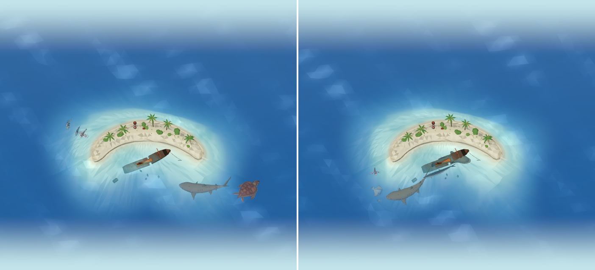

# The Shipwreck

The archipelago's fifth island (`docs/archipelago.md`): a low crescent of white sand dunes, with
an old steamer wrecked in its bight, in gin-clear water over white sand. It rises the first time
the diver logs a Shipwreck species; from then on Home's area pills switch to it, and in the explorer
it lies at the chain's southern end, beyond the Mangroves & Seagrass, in the same ocean
(`docs/island-explorer.md#one-ocean`). Its own animals (the five below, and the great barracuda,
the giant grouper, the green moray and the circular batfish, which swim as their fellow species'
models) swim here.

## The island

`src/components/home/three/wreck-coast.tsx` builds it in the island's own (scaled) frame, from the
building blocks it shares with the other coasts (`coast-geometry.ts`, and the Coral Reef's palms and
foliage in `reef-coast.tsx`):

- **The shape.** A crescent curving round a bight on its south side, thick in the middle, its arms
  tapering to points: small and low (`OUTLINES.wreck` in island-outline.ts).
- **The cay.** White sand rising from the water to low dunes along the crescent, with a line of
  wrack at the top of the beach; beach grass in tufts over the dunes, thinner toward the beach; sea
  grape and low shrubs, and mats of beach vine creeping over the sand; a few coconut palms;
  bleached driftwood on the beaches, and a boulder or two off the points.
- **The lighthouse.** On the crescent's northern point a small lighthouse, its tapering white tower
  banded red, a gallery round its lantern under a red cap, and the keeper's whitewashed hut beside
  it under a red roof (`LIGHT`, `HUT`).
- **The wreck.** An old steamer, run aground long ago in the bight (`WRECK` in `src/lib/wreck.ts`):
  her bow up by the sand of the crescent's inner shore, her hull listing to seaward as it runs down
  into deeper water, her back broken so the stern half has sunk lower, twisted aside and lists
  harder. Her deck's rotten planking has fallen through into the holds in places; her deckhouse stands
  amidships, her funnel leaning aft, her foremast still up and her mainmast broken off short. All of
  her is rusted, streaked orange above the water and weed-grown, with a little pink coral, below
  it. Her anchor lies off the bow on its chain, her boiler broke away aft, and plates of her hull lie
  scattered on the bottom. What stands above the water is drawn with the island; what lies under it
  is drawn like the reef's rocks (behind any animal over it), taking on the clear water's colour.
- From level 5 the islets (`islets()` in island-outline.ts) rise as little cays of sand with grass
  and a palm.

## The water

The Shipwreck's palette (`OCEAN.palettes.wreck` in `src/lib/ocean.ts`) is the clearest of all:
bright aquamarine shallows over white sand deepening to sapphire, so the wreck and the animals round
her show a long way down. The card behind the scene is a pale aqua to match (`WATER.wreck`). It is
the ocean's fifth water, so the region maps carry it on their second map (`OCEAN_REGIONS`,
`docs/ocean.md`).

## Its animals

| Species | Swims | Movement |
| --- | --- | --- |
| Sand tiger shark | Slow sweeps of the tail, almost motionless at rest | Hangs almost still in mid-water by the wreck, then drifts on |
| Loggerhead turtle | Slow, heavy strokes of its short fore flippers, long glides | Swims heavily and steadily round the wreck and out over the sand |
| Goliath grouper | Slow, heavy beats | Hangs by the wreck, barely moving, and turns slowly to watch |
| Lionfish | Hovers, its fans breathing slowly | Hovers by the wreck with its fins spread, edging along now and then |
| Batfish | Gentle beats, gliding | A school of three to five gliding round the wreck together |

The models and rigs are in `docs/marine-species-art.md` (batch v9); their settings in
`src/lib/marine-motion.ts`, `marine-rigs.ts` and `marine-groups.ts`. The Caribbean spiny lobster
has no model yet.

Tests: `src/lib/__tests__/shipwreck.test.ts` (the island and its residents, the crescent and where
the wreck lies in it, and how its animals swim). `npm run verify:ocean` checks the Shipwreck's water
is its own.

## Known limitations

- The wreck is scenery: the animals don't shelter inside her or keep to her, only round the cay.
- The lighthouse never lights.
- Nothing grows on the wreck as the levels go up.
