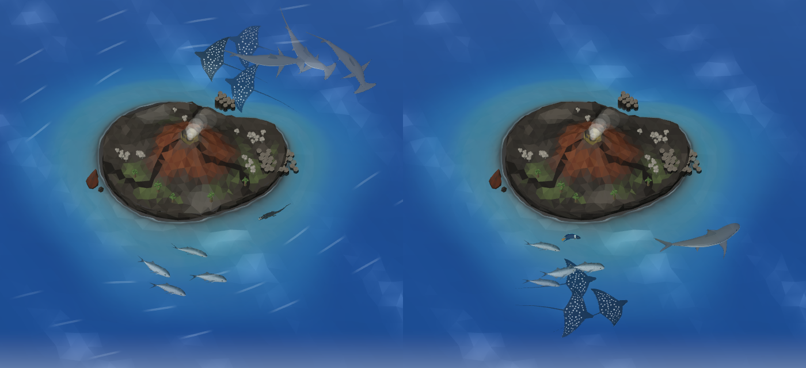

# The Volcanic Pinnacle

The archipelago's third island (`docs/archipelago.md`): a young lava cone rising steeply out of
clear, current-swept blue water, like the Galápagos' Bartolomé and Fernandina. It rises the first
time the diver logs a Volcanic Pinnacle species; from then on Home's area pills switch to it, and
in the explorer it lies to the south-west of the reef, in the same ocean
(`docs/island-explorer.md#one-ocean`). Its own animals (the five below, and the scalloped
hammerheads and spotted eagle rays, which live here) swim here; everything else swims at its own
area's island or at Home's.

## The island

`src/components/home/three/volcanic-coast.tsx` builds the island as one flat-shaded,
vertex-coloured mesh in the island's own (scaled) frame, from the building blocks it shares with
the Kelp Forest's coast (`coast-geometry.ts`: noise, face painting, a Delaunay triangulation,
rough cliffs and boulders):

- **The cone** (`CONE`, `coneAt`). It fills most of the island (the same outline the animals steer
  around), steep and slightly concave like a cinder cone, longer east to west where the island is
  longer, ribbed by gullies, with a crater at the summit. The ground is a jittered lattice of points
  joined by a Delaunay triangulation, with rings of points about the summit so the crater's rim is
  a crisp edge.
- **Colour.** Dark basalt low down; rust-red cinder and patches of ash higher up; a pale band of
  ash about the rim and, inside the crater, ash stained with sulphur. Three fresh lava flows run
  down from the rim (`FLOWS`), glossy black and a little raised. Low on the sunny south side, green
  scrub in soft patches.
- **The shore.** Black basalt walls from under the waterline (`FOOT`) to the shore (`TOP`) and black
  boulders along the waterline; in two coves (`COVES`) the walls come down (`cliffs`' `cap`) and a
  beach of black sand, smooth and a little lighter than the rock, slopes gently down to the water's
  edge (`BEACH`).
- **Plants.** Galápagos tree cactus (*Opuntia*) on the south slopes: a short trunk under a crown of
  flat oval pads; and groves of palo santo, pale, leafless and silvery, on the lower slopes (the
  dry season's ghost forest), which light the dark island from above.
- **Basalt columns.** A causeway of hexagonal columns stepping down into the sea on the east point,
  their tops weathered paler, and a stack of columns off the north shore. From level 5 the islets
  (`islets()` in island-outline.ts) rise as low lava rocks capped with columns.
- **The pinnacle.** A lone, eroded spire of reddish tuff standing off the west point, two smaller
  rocks at its foot.
- **The vent.** A dull glow of hot rock in the crater floor (unlit, so it shows), and steam
  (`STEAM`): puffs rise from it one after another, swelling and thinning as the wind carries them
  off east, on the island's water clock, so they still when the scene does.

## The water

The Volcanic Pinnacle's palette (`OCEAN.palettes.volcanic` in `src/lib/ocean.ts`) is clear and
blue: bright blue-teal shallows over the dark bottom, deepening fast to cobalt, over black sand.
Its `clarity` makes the water clearer than the tropics': things are seen deeper (`visibility`),
the seabed shows farther (`seabed`), and the surface is more transparent (`opacity`). The card
behind the scene is a pale blue to match (`WATER.volcanic`).

**The current.** Faint lines of foam sweep past the island (`CURRENT`), bending round it as a stream
bends round a stone (the streamlines of flow past a circle), dashes of foam drifting downstream
along them. They ride the waves (the same `oceanWave` as the water, flat in lite quality), run on
the island's water clock and fade toward the view's hazy edges. In the one ocean, the water blends from
the reef's turquoise to this cobalt across the open sea between them (`docs/ocean.md`).

## Its animals

| Species | Swims | Movement |
| --- | --- | --- |
| Marine iguana | Swims like a crocodile: legs folded back along its flanks, the long, flattened tail sweeping it along in waves that grow toward the whip of its tip (`TailUpper`), the head held steady | Close to the shore and high in the water; comes up to breathe and lingers at the surface, hangs still now and then, drifting with the swell |
| Galápagos shark | Steady, confident beats of the tail, the stiff front carrying the tall dorsal fin level | Patrols the island's drop-offs, swinging out and back |
| Pelagic thresher | Slow, deep strokes of a compact body, the great scythe of the upper tail lobe trailing each one, bending along its whole length | Long, wide arcs out in the blue and deeper down |
| Giant trevally | A stiff-bodied jack: quick, strong beats packed into the narrow tail stock and the forked tail | A hunting pack of three to five in tight formation (`GROUP_STYLES`), cutting across, easing off, then charging in a burst |
| King angelfish | Rows slowly on its pectorals, the tall disc of a body tilting and turning on the spot | Keeps to the rocks in the shallows, hangs a while and swims on; rocks with the surge |

And the scalloped hammerheads, which school here: two or three swimming loosely together
(`GROUP_SIZES`), each still its own animal; and the spotted eagle rays, a squadron in formation.

The models and rigs are in `docs/marine-species-art.md` (batch v7); their settings in
`src/lib/marine-motion.ts`, `marine-rigs.ts` and `marine-groups.ts`. The chevron barracuda swims as
the great barracuda; the marbled ray, the dogtooth tuna and the chambered nautilus as their
family's model or not yet at all.

Tests: `src/lib/__tests__/volcanic-animals.test.ts` (the island and its residents, the iguana's tail
and the thresher's, the hammerhead school and the trevally pack, who keeps to the shore, who keeps
out in the blue).

## Known limitations

- From the explorer's top-down view the cone's height reads from its shading and the summit's
  shift on screen; from low angles it reads best.
- The iguanas swim but never haul out to bask on the rocks.
